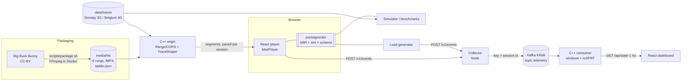

# Adaptive video streaming platform

An end-to-end adaptive-bitrate (ABR) streaming system built from scratch:

- **Packaging**: FFmpeg turns Big Buck Bunny into a 6-rung H.264 ladder (240p–1080p) with aligned
  4 s GOPs, as HLS with CMAF/fMP4 segments.
- **Origin (C++20)**: a hand-written HTTP/1.1 server with Range, CORS and correct MIME types, plus a
  per-session **bandwidth shaper** that replays a network trace.
- **Player (React + TypeScript)**: drives Media Source Extensions directly. The ABR is pluggable,
  with a throughput rule (harmonic mean × safety), BBA-0, BBA with a startup guard, BBA-1 (VBR
  chunk map, dynamic reservoir), BOLA-BASIC and dash.js-style BOLA-E.
- **Simulator (Node)**: runs the *same* ABR module against 125 real 3G/4G traces, in about 80 ms.
- **Telemetry**: player/loadgen → collector → **Kafka (KRaft)** → **C++ consumer**, with per-arm
  windowed aggregation and an **mSPRT always-valid sequential test**.
- **A/B dashboard (React)**: live per-arm metrics, the test's p-value, CI and decision.
- **docker-compose** brings up the whole stack. A load generator emits telemetry from many
  simulated sessions.

See [RESULTS.md](RESULTS.md) for every measured number with raw output.

## Architecture



## Quick start

Prerequisites: Docker, Node ≥ 22, CMake ≥ 3.24, a C++20 compiler, Ninja, and Google Chrome (for the
e2e test only). FFmpeg is *not* needed on the host because it runs in a container.

```bash
npm install                               # TS workspaces
scripts/fetch_source.sh                   # Big Buck Bunny (275 MB, not committed)
scripts/package.sh                        # 6-rung ladder into media/hls (~1.5 min on an M3)
scripts/verify_media.sh                   # checks GOP alignment of all 288 segments
scripts/fetch_traces.sh                   # Norway HSDPA + Belgium 4G traces into data/traces

docker compose up -d --build --wait       # kafka, origin :8080, collector :8081, consumer :8082, dashboard :8083
open http://localhost:8083/               # dashboard
open "http://localhost:8083/player/?trace=norway/bus.ljansbakken-oslo_report.2010-09-28_1407CEST&autoplay=1"
docker compose --profile load run --rm loadgen --rate 20 --duration-s 600 --inject B:300
```

## Build and test

```bash
# C++ (release, and debug = ASan + UBSan)
cmake --preset release && cmake --build --preset release && ctest --preset release
cmake --preset debug   && cmake --build --preset debug   && ctest --preset debug

# TypeScript
npm test                    # vitest: ABR, simulator, HLS parser, assignment, telemetry, collector, loadgen
npm run typecheck           # tsc --noEmit (strict) for every workspace

# End-to-end (headless Chrome through the shaper, with telemetry)
e2e/run.sh

# Full stack smoke test through Kafka
scripts/smoke_compose.sh
```

The Docker build of the C++ image also runs the whole C++ test suite under GCC 12 on Linux.

## Run pieces individually

```bash
build/release/avs_origin --root media --trace-dir data/traces --port 8080
#   shaped request: GET /hls/v5/seg_3.m4s?trace=norway/<name>&sid=<session>[&rtt_ms=80][&toffset=30]
SINK=memory npx tsx services/collector/src/main.ts
npx tsx services/loadgen/src/main.ts --dry-run --rate 50 --duration-s 30 --inject B:1000 \
  | build/release/avs_consumer --stdin --exit-on-eof            # whole pipeline without Kafka
npx tsx packages/abr/src/cli/simulate.ts --trace traces/synthetic/step.txt --abr bba-guard
npm run dev -w @avs/player     # http://localhost:5173/?trace=synthetic/step&autoplay=1
npm run dev -w @avs/dashboard  # http://localhost:5174/
```

## Benchmarks

| Script | What it measures |
|---|---|
| `bench/abr_compare.sh` | Throughput vs BBA vs BBA-guard over 125 traces × 5 offsets, paired bootstrap CIs |
| `bench/abr_sensitivity.sh` | The same comparison under other parameters (in-sample) |
| `bench/abr_heldout.sh` | BBA-1/BOLA/BOLA-E tuned on a stratified train half of the traces, reported on the held-out half |
| `bench/abr_heldout_seeds.sh` | The held-out pipeline for split seeds 2–5 (robustness of the split) |
| `bench/abr_followup.sh` | Reruns compare + sensitivity + held-out + seeds with one command |
| `bench/aa_fpr.sh` | A/A false-positive rate of the mSPRT checked after every observation, vs naive peeking |
| `bench/detect_offline.sh` | Time to detect a startup regression vs traffic rate and effect (statistics only) |
| `bench/detect_live.sh` | Time to detect +300 ms through the live docker-compose pipeline, several runs |

## Results (measured; details and raw output in RESULTS.md)

Apple M3, 16 GiB, macOS 15.7.

| Question | Measured |
|---|---|
| Rebuffering cut, BBA vs throughput baseline (125 traces) | **BBA rebuffers 16.0% more** (95% CI 10.4–23.5% more). Rebuffer ratio 7.3% → 8.4%. On 3G BBA gains +194 kbps; on 4G it loses 694 kbps and adds 3.7 switches/session. |
| Rebuffering cut, BBA-1 / BOLA / BOLA-E with paper defaults (125 traces) | **All rebuffer more.** BBA-1 −17.2% [−24.8, −11.7], BOLA −15.1% [−21.7, −10.3], BOLA-E −8.4% [−13.3, −5.1] (negative = more stalls) |
| Same, tuned on train, **held-out test** (63 traces) | Pre-registered picks: BBA-1 +3.0% [−1.5, 8.9], BOLA −10.5% [−18.4, −5.6], BOLA-E (Q_low 30) +3.4% [0.3, 7.7], which does not survive other splits. Extended grid: BOLA-E (Q_low 50) **+8.4% [4.1, 14.4]** for −61 kbps (−79 kbps on 3G). All gains are on 3G; on 4G nobody stalls, and BBA-1/BOLA lose ~600 kbps. |
| A/A false-positive rate, mSPRT checked after every observation | **0.96%–3.80%** on 4 distributions (5000 experiments each). Naive repeated t-test: 43–46%. |
| Time to detect +300 ms startup regression (offline stats, 10 s cap) | median **273 s** at 10 sessions/s (p90 500 s); **131 s** at 20/s; **521 s** at 5/s |
| Time to detect +300 ms through the live pipeline (Kafka, C++ consumer) | **3/3 at 10 sessions/s, median 366 s** (max 369 s); **5/5 at 20/s, median 127 s** (41–212 s); **3/3 at 50/s, median 41 s**. A/A live: 0/2 false positives in 10 min |
| E2E: real stream in headless Chrome through the shaper | passes: rung sequence up 0→5 then down, telemetry received |

## Repository layout

```
cpp/          C++20: http/ (server), shaper/, origin/, stats/ (mSPRT), consumer/, bench/, tests/
packages/abr  shared TS: ABR algorithms, HLS parser, simulator, assignment, telemetry schema, CLIs
apps/         player/ (React MSE player), dashboard/ (React A/B dashboard)
services/     collector/ (HTTP → Kafka), loadgen/ (simulated sessions)
e2e/          Playwright test
scripts/      fetch/package/verify media, fetch/convert traces, compose smoke test
bench/        benchmark entry points (outputs in bench/out/, git-ignored)
docker/       multi-target Dockerfile (cpp, node, web) and the FFmpeg toolbox image
traces/       small synthetic traces authored for tests (committed)
```

## Data sources and licences

Data is downloaded by scripts and never committed.

- **Video**: *Big Buck Bunny* © Blender Foundation, CC-BY 3.0 (peach.blender.org),
  `bbb_sunflower_1080p_30fps_normal.mp4` from download.blender.org.
- **Norway HSDPA 3G bandwidth logs**: Riiser, Vigmostad, Griwodz, Halvorsen, "Commute Path
  Bandwidth Traces from 3G Networks: Analysis and Applications", ACM MMSys 2013. Downloaded from
  Simula's dataset page (https://datasets.simula.no/hsdpa/). The page marks it free to access and
  asks users to cite the paper. **No formal open-source licence is stated.**
- **Belgium 4G/LTE bandwidth logs**: van der Hooft et al., "HTTP/2-Based Adaptive Streaming of
  HEVC Video Over 4G/LTE Networks", IEEE Communications Letters 2016
  (https://users.ugent.be/~jvdrhoof/dataset-4g/). Public research dataset, cite on use. **No formal
  licence is stated.**
- **FCC Measuring Broadband America** (US government work, public domain): not used. data.fcc.gov
  returned HTTP 403 to scripted downloads from this machine. See RESULTS.md TODO.
- `traces/synthetic/*.txt` were written for this project (public domain).

## Dependencies (all permissive)

| Dependency | Licence | Used for |
|---|---|---|
| nlohmann/json 3.11.3 | MIT | consumer JSON (CMake FetchContent) |
| GoogleTest 1.15.2 | BSD-3-Clause | C++ tests (FetchContent) |
| librdkafka (Debian `librdkafka-dev`) | BSD-2-Clause | consumer Kafka source |
| React, React DOM 18 | MIT | player, dashboard |
| Vite 5, @vitejs/plugin-react | MIT | web builds |
| TypeScript 5 | Apache-2.0 | all TS |
| tsx | MIT | running TS in Node |
| Vitest 2 | MIT | TS tests |
| kafkajs 2 | MIT | collector producer |
| @playwright/test | Apache-2.0 | e2e |
| apache/kafka 3.9.0 image | Apache-2.0 | broker (KRaft) |
| FFmpeg + x264 (Debian packages, in a container) | LGPL/GPL | invoked as a tool only; not linked or redistributed |
